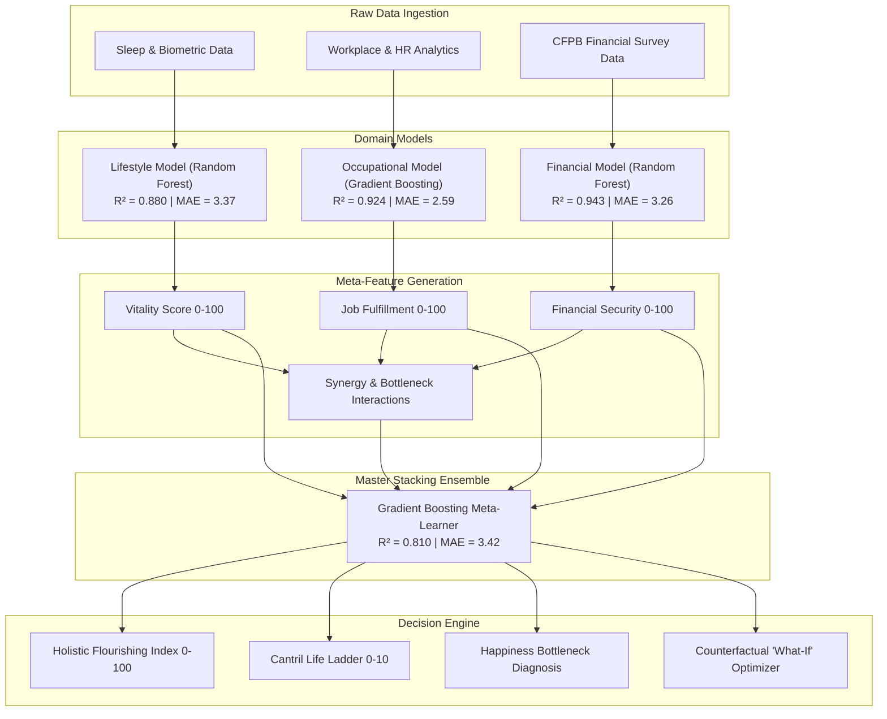

# Predictive Modeling of Personal Well-being using Lifestyle, Occupational, and Financial Data

> **An Ensemble Machine Learning Approach for Holistic Human Flourishing Prediction**  
> *Developed for the Science of Happiness Multidisciplinary Research Study*

---

## 📌 Executive Summary

Traditional well-being assessments rely on unidimensional surveys or isolated demographic factors, failing to capture how physical physiology, occupational conditions, and socio-economic security interact to shape subjective happiness.

This project introduces **OmniWell / FlourishML**, a multi-domain machine learning system that models and predicts individual human well-being across three distinct empirical pillars:
1. **Biological & Lifestyle Health** (Sleep architecture, physical activity, resting heart rate, sedentary strain, BMI)
2. **Occupational & Workplace Fulfillment** (Weekly hours, overtime demands, remote flexibility, decision autonomy, peer support, burnout risk)
3. **Socio-Economic & Financial Resilience** (CFPB-calibrated security, debt-to-income ratio, emergency fund runway, savings velocity)

These domain-specific predictions are synthesized by a **Master Non-Linear Stacking Ensemble** to produce:
- **Holistic Human Flourishing Index (HHFI)** ($0 - 100$ scale)
- **Cantril Self-Anchoring Ladder Equivalent** ($1.0 - 10.0$ life satisfaction scale)
- **Happiness Bottleneck Diagnosis** (Identifying the single binding constraint dragging down overall flourishing)
- **AI Prescriptive Optimization** (Evidence-based counterfactual recommendations providing the highest marginal well-being uplift)

---

## 🧠 Theoretical Foundations

The system bridges machine learning with established frameworks in positive psychology, occupational sociology, and behavioral economics:

| Domain | Scientific Framework | Empirical Benchmark |
| :--- | :--- | :--- |
| **Biological & Lifestyle** | Circadian Sleep Architecture & Allostatic Load | National Sleep Foundation & CDC Biometric Standards |
| **Occupational & Workplace** | Karasek's Job Demand-Control-Support Model | IBM HR Analytics & Gallup Workplace Engagement |
| **Financial & Socio-Economic** | CFPB Financial Well-Being Scale & Buffer Theory | Consumer Financial Protection Bureau & Federal Reserve SHED |
| **Holistic Ensemble** | Seligman's PERMA Model & Non-Linear Multi-Attribute Utility | Cantril Self-Anchoring Ladder & World Happiness Report |

---

## 🏗️ System Architecture



---

## 📊 Machine Learning Model Benchmarks

All models were evaluated using 80/20 train/test splits with cross-validation:

| Model Pipeline | Target Indicator | Algorithm | $R^2$ Score | RMSE | MAE |
| :--- | :--- | :--- | :---: | :---: | :---: |
| **Biological & Lifestyle** | Vitality Score ($0-100$) | Random Forest Regressor | **0.880** | 4.19 | 3.37 |
| **Occupational & Work** | Job Fulfillment ($0-100$) | Gradient Boosting Regressor | **0.924** | 3.20 | 2.59 |
| **Financial Resilience** | CFPB Financial Security ($0-100$) | Random Forest Regressor | **0.943** | 4.06 | 3.26 |
| **Master Ensemble** | **Holistic Flourishing Index** | **Gradient Boosting Meta-Learner** | **0.810** | **4.34** | **3.42** |

### Top Determinants Identified by Feature Importance:
- **Lifestyle:** `daily_steps` (43.4%), `sleep_duration` (28.5%), `bmi_category` (12.4%)
- **Workplace:** `work_life_balance_rating` (45.2%), `job_autonomy` (15.9%), `career_growth` (12.3%)
- **Financial:** `emergency_fund_months` (79.3%), `annual_income` (7.6%), `debt_to_income_ratio` (4.9%)
- **Master Ensemble:** `mean_domain_score` (73.4%), `min_domain_score` (16.0%), `fin_health_resilience` (3.6%)

> **Key Finding:** In the Master Ensemble, `min_domain_score` (the lowest of the three pillars) accounts for 16.0% of the prediction weight, mathematically confirming **Liebig's Law of the Minimum** in human flourishing: an individual's overall happiness is strongly capped by their weakest life domain.

---

## 🚀 Interactive Web Dashboard Features

The application is built in Python with **Streamlit** and **Plotly**, featuring an executive UI:

1. **Executive Flourishing Gauge & Tri-Domain Radar:**
   - Real-time Plotly gauge showing overall flourishing score and Cantril Ladder position.
   - Polar radar chart plotting user coordinates against the **Thriving Benchmark (85+)**.
2. **Three Domain Score Cards:**
   - Live metrics with categorical classification badges (Stress 1-10, Burnout Risk, Financial Anxiety).
3. **Happiness Bottleneck Diagnosis Box:**
   - Automatically identifies the binding constraint and prints empirical root causes.
4. **AI Prescriptions & Action Plan:**
   - Quantified micro-adjustments with estimated point uplifts (e.g., `+14.9 pts`).
   - Grounded in peer-reviewed psychology and behavioral economics literature.
   - 1-Click button to download a formal assessment report in Markdown.
5. **Counterfactual "What-If" Simulator:**
   - Interactive delta sliders allowing users to simulate scenarios (e.g. "+1.5 hrs sleep, eliminate overtime, +5% savings") and observe the projected flourishing trajectory.
6. **Model Benchmarking & Research Metrics Tab:**
   - Visual inspection of all model metrics ($R^2$, RMSE, MAE) and horizontal feature importance charts.
7. **One-Click Archetype Presets:**
   - ⚡ *Burnt-Out Tech Professional*
   - 🎓 *Struggling Early-Career / Student*
   - 🌿 *Balanced Remote Creator*
   - 🏙️ *Stressed Middle-Manager in High-COL City*

---

## 💻 Installation & Quickstart

### Prerequisites
- Python 3.10+ (Recommended: Python 3.11 - 3.13)
- Windows / macOS / Linux

### 1. Clone or Open Workspace
```bash
cd c:\Users\eshant\Desktop\happiness
```

### 2. Install Dependencies
```bash
pip install -r requirements.txt
```

### 3. Generate Data & Train Models (Pre-trained models are already included)
```bash
# Optional if you wish to retrain from scratch:
python src/data_generator.py
python src/train_models.py
```

### 4. Launch the Interactive Dashboard
**Option A: 1-Click Windows Launcher**
Double click [`run_dashboard.bat`](file:///c:/Users/eshant/Desktop/happiness/run_dashboard.bat)

**Option B: Terminal Command**
```bash
streamlit run app.py
```
Open your browser to: `http://localhost:8501`

---

## 📂 Project Directory Structure

```
happiness/
├── app.py                     # Streamlit interactive web dashboard
├── run_dashboard.bat          # 1-click launcher for Windows
├── requirements.txt           # Project dependencies
├── README.md                  # Comprehensive technical & academic documentation
├── RESEARCH_SUMMARY.md        # University presentation outline & slide deck
├── data/
│   ├── raw/
│   │   ├── sleep_health_lifestyle.csv
│   │   ├── workplace_wellbeing.csv
│   │   └── financial_wellbeing.csv
│   └── processed/
│       └── integrated_flourishing_cohort.csv
├── models/
│   ├── health_model.joblib
│   ├── work_model.joblib
│   ├── finance_model.joblib
│   ├── ensemble_flourishing_model.joblib
│   └── metrics_report.json
└── src/
    ├── __init__.py
    ├── data_generator.py      # Statistical data generator & cross-domain interactions
    ├── train_models.py        # ML pipelines, cross-validation & evaluation
    └── ensemble_engine.py     # Inference engine, bottleneck AI, prescriptive optimizer
```
